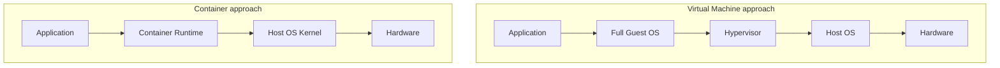

# Chapter 1 — Container Fundamentals

## Concept
A container is an isolated process running on your existing Linux kernel.
It is **not** a lightweight VM — there is no second OS booting underneath it.
Docker uses three kernel features to fake "its own machine" for a process:

- **Namespaces** — give the process its own view of PIDs, network
  interfaces, mounts, hostname. It *thinks* it's the only thing running.
- **cgroups** — limit how much CPU/memory/IO that process can use.
- **Union filesystem (overlayfs)** — layer read-only image files with a
  writable layer on top, so containers from the same image share disk space.

## Mental model
A VM virtualizes hardware. A container virtualizes the *operating system's
process view*. That's the whole trick — and it's why containers start in
milliseconds instead of the minute-plus a VM boot takes.

## Diagram


Containers are lightweight because there's only ever **one kernel** — the
host's. Every container is just a regular Linux process with extra
isolation flags set by the runtime, sharing that one kernel.

## Docker's pieces
- **Docker Engine** — the daemon (`dockerd`) that does the actual work.
- **Docker CLI** (`docker`) — talks to the daemon over a socket/API.
- **Docker Desktop** — on Mac/Windows, runs a tiny Linux VM to host the
  daemon (because those OSes have no Linux kernel to share) — the CLI still
  feels native.
- **OCI (Open Container Initiative)** — the spec that makes an image built
  by Docker runnable by containerd, Podman, or Kubernetes without change.

## Implementation — see it with your own eyes
```bash
bash examples/inspect_isolation.sh
```
This runs a container and shows you, from inside it, that it has its own
PID 1, its own hostname, and its own filesystem root — while `ps aux` on
your host shows that same process as an ordinary PID.

## Run / Observe
```bash
docker run --rm alpine ps aux        # inside: sees only itself as PID 1
ps aux | grep sleep                   # outside: same process, ordinary PID
```

## Break it
```bash
docker run --rm alpine sh -c "kill -9 1"
```
Killing PID 1 inside a container kills the whole container immediately —
because in this namespace, PID 1 *is* the container's entire universe.

## Debug
`docker inspect <id>` shows you the real host-side PID under
`.State.Pid`. That's the same process — just wearing a namespace mask.

## Production implications
- Namespace isolation is NOT the same as VM-grade security isolation — a
  kernel exploit can cross container boundaries (see chapter10).
- "It shares the host kernel" is why you can't run a Windows container on
  a Linux host, or an ARM image on an x86 host without emulation.

## Exercise
See `exercises/01-isolation.md`.
