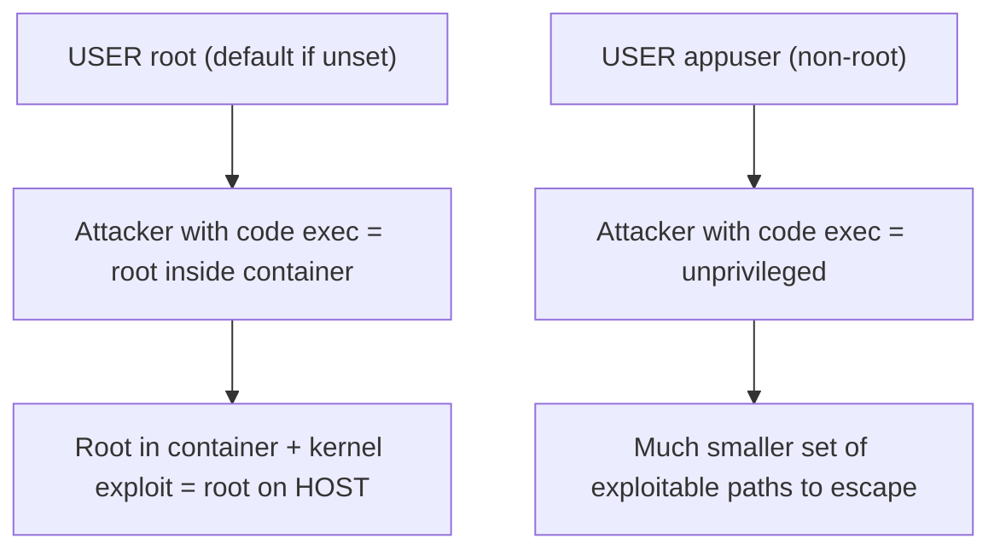

# Chapter 10 — Container Security

## Concept
A container is not a security boundary by default — it shares the host
kernel (chapter1). Hardening a container is about minimizing what an
attacker gains *if* they get code execution inside one: no root, no
unnecessary tools, no writable filesystem where it isn't needed, no
excess Linux capabilities, and no known-vulnerable dependencies.

## Mental model
Assume the container will eventually be compromised (a bad dependency, an
injection bug). Every hardening step here is about **limiting blast
radius**, not preventing compromise entirely.

## Diagram


## Why `USER root` (the default) is dangerous
If you never set `USER`, every process in the container runs as UID 0.
Combined with a container-escape kernel vulnerability, that's a direct
path to root on the host. Nearly all production hardening starts with:
```dockerfile
RUN useradd --create-home --uid 1000 appuser
USER appuser
```

## Implementation — build a secure container
`examples/Dockerfile.secure` combines:
- non-root `USER`
- minimal base (`-slim`, no dev tools)
- read-only root filesystem at runtime (`docker run --read-only`)
- dropped Linux capabilities (`--cap-drop=ALL`)
- resource limits (chapter11)

```bash
docker build -f examples/Dockerfile.secure -t secure-demo examples
docker run --rm --read-only --cap-drop=ALL --user 1000:1000 \
  --tmpfs /tmp secure-demo id
```

## Run / Observe
```bash
docker run --rm secure-demo id            # uid=1000(appuser), not 0
```

## Break it
```bash
docker run --rm examples-insecure whoami   # root
docker run --rm examples-insecure sh -c "touch /etc/newfile && echo wrote as root"
```

## Debug — scanning for known vulnerabilities
Small doesn't mean safe — a small image can still bundle a package with a
known CVE. Use a scanner:
```bash
docker scout cves secure-demo        # if Docker Scout is available
# or: trivy image secure-demo
```
Never assume "it's Alpine, it's fine" — check.

## Production implications
- `--read-only` + `--tmpfs /tmp` (or wherever the app needs scratch space)
  stops most "attacker writes a webshell to disk" attacks outright.
- `--cap-drop=ALL` then `--cap-add` back only what's strictly needed
  (rarely anything, for a typical web app) follows least privilege.
- Pin dependency and base image versions — `latest` today is not
  `latest` next month, and you want reproducible, auditable builds
  (chapter22 covers supply-chain risk in the pipeline itself).

## Exercise
See `exercises/01-security.md`.
