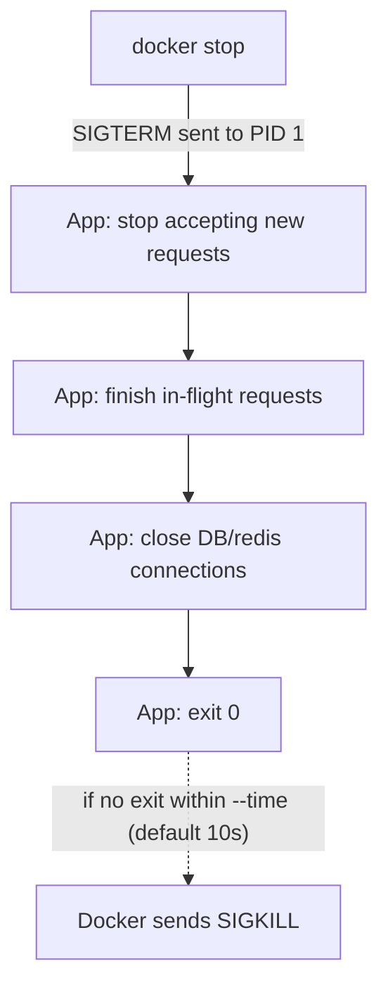

# Chapter 11 — Container Resource Management

## Concept
Without limits, one runaway container can starve every other process on
the host of CPU or memory. Docker enforces limits via **cgroups**
(chapter1). Separately, every container needs to shut down *cleanly* when
asked — that's a signal-handling problem, not a resource one, but the two
are grouped here because both are "the container as a good citizen on a
shared host."

## Mental model
Limits are a contract: "you may use up to X, and if you try to exceed
memory, you get killed (OOM), not the whole host." Graceful shutdown is a
second contract: "when told to stop, finish in-flight work and exit — you
don't get to hang forever."

## Diagram


## Implementation — limits
```bash
docker run -d --name limited --memory=100m --cpus=0.5 alpine sleep 300
docker stats limited --no-stream
```

## Run / Observe — OOM kill
```bash
docker run --rm --memory=50m python:3.12-slim \
  python -c "x = bytearray(200 * 1024 * 1024)"
docker inspect <container-id> --format '{{.State.OOMKilled}}'   # true
```

## Break it — PID 1 ignoring SIGTERM
`examples/bad_signal_handler.py` never handles SIGTERM. `docker stop` on
it will hang for the full grace period, then get SIGKILLed:
```bash
docker build -f examples/Dockerfile.bad -t bad-signals examples
docker run -d --name bad bad-signals
time docker stop bad     # takes ~10s — the full default grace period
```

`examples/good_signal_handler.py` handles SIGTERM and exits immediately:
```bash
docker build -f examples/Dockerfile.good -t good-signals examples
docker run -d --name good good-signals
time docker stop good    # exits almost instantly
```

## Debug
```bash
docker stats                          # live CPU/mem per container
docker inspect <id> --format '{{.State.OOMKilled}}'
docker logs <id>                      # did the app log anything before dying?
```

## Production implications
- Set memory limits deliberately based on measured usage + headroom, not
  guesses — too tight causes mysterious OOM kills under normal load.
- Every production app should catch SIGTERM and shut down within whatever
  grace period your orchestrator gives it (Kubernetes default: 30s) —
  otherwise every deploy/scale-down is a small outage for in-flight
  requests.
- Uvicorn/Gunicorn and most frameworks handle this for you if you don't
  swallow the signal yourself — verify it, don't assume it.

## Exercise
See `exercises/01-resources.md`.
