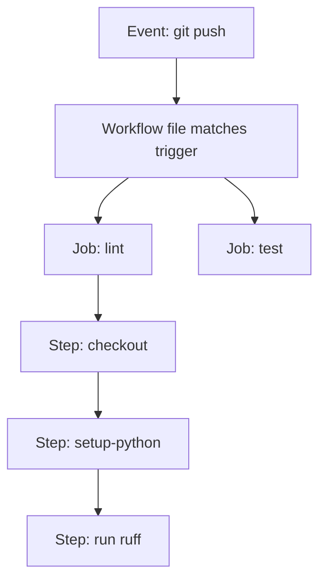

# Chapter 12 — GitHub Actions Fundamentals

## Concept
GitHub Actions runs YAML-defined **workflows** in response to repo
**events** (push, PR, schedule, manual dispatch). A workflow contains one
or more **jobs**, each running on its own fresh **runner** (a VM), made of
sequential **steps** — each step either runs a shell command or invokes a
reusable **action**.

## Mental model
A workflow is a function: `event -> jobs`. Each job is an independent,
disposable VM — nothing persists between jobs except what you explicitly
pass via **artifacts** or a cache.

## Diagram


## Anatomy of a workflow file
```yaml
name: CI                          # shown in the Actions tab
on: [push, pull_request]          # event(s) that trigger this workflow
jobs:
  build:                          # job id
    runs-on: ubuntu-latest        # runner OS
    steps:
      - uses: actions/checkout@v4          # an action (reusable step)
      - uses: actions/setup-python@v5
        with: {python-version: "3.12"}
      - run: pip install -r requirements.txt   # a raw shell command
      - run: pytest
```

## Implementation
`examples/.github/workflows/hello.yml` — the minimal workflow: checkout,
setup Python, install deps, lint, test. This is chapter13's pipeline,
introduced here in its simplest form.

## Run / Observe
You need a real GitHub repo to see Actions execute (it's not a local
tool). Push this repo (or just this chapter's example) to GitHub and check
the "Actions" tab — you'll see the workflow run, one row per job, expandable
per step, each with full logs.

## Break it
Introduce a syntax error (bad indentation) in the workflow YAML and push.
GitHub will refuse to even start the workflow and show a parse error in
the Actions tab instead of any job output — YAML indentation errors are
the #1 cause of "my workflow doesn't even appear."

## Debug
- The Actions tab UI shows exact step-by-step logs and timing.
- `act` (a local GitHub Actions runner) lets you dry-run workflows on your
  own machine without pushing — useful for iterating on YAML quickly.

## Production implications
- Matrix builds (`strategy: matrix:`) let you run the same job across
  multiple Python/OS versions in parallel — critical once you support
  more than one runtime target.
- Every job is a *fresh* VM — no assumption of shared state across jobs
  unless you explicitly pass artifacts or restore a cache.

## Exercise
See `exercises/01-actions-basics.md`.
