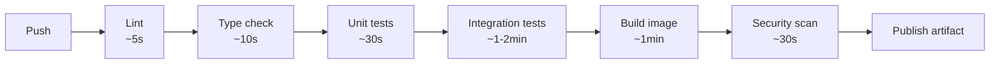

# Chapter 13 — CI Pipelines

## Concept
CI exists to answer one question, automatically, on every push: **"is
this change safe to merge?"** A real CI pipeline is a sequence of gates —
lint, type-check, unit tests, integration tests, build, scan — where each
gate fails fast and cheap before the next, more expensive gate runs.

## Mental model

Order matters: fail on the $0.01 problem (a lint error) before spending
time on the $1 problem (spinning up Postgres for integration tests).

## Implementation
`examples/.github/workflows/ci.yml` builds this exact pipeline against the
`sample-app`, including a real Postgres+Redis **service container** for
integration tests — this is the GitHub Actions equivalent of chapter7's
Compose stack, scoped to one job's lifetime.

## Run / Observe
Push to GitHub, watch each step run in order in the Actions tab. Note how
`pytest` for integration tests connects to `localhost:5432` — GitHub
exposes service containers on `localhost` inside the job's runner network,
unlike Compose's named-service DNS (chapter5/7).

## Break it
Comment out the `ruff check` step's `continue-on-error: false` equivalent
(i.e. make lint fail) and push a lint violation. Confirm later steps
(tests, build) never even start — that's the "fail fast" contract working.

## Debug
- `actions/cache@v4` to cache pip downloads between runs — without it,
  every run reinstalls every dependency from scratch. Compare timing
  with and without the cache step.
- Enable `ACTIONS_STEP_DEBUG` repo secret for verbose step logs when
  something's failing mysteriously.

## Production implications
Parallelize independent gates (lint and unit tests don't depend on each
other) using separate jobs; keep genuinely sequential gates (build after
tests pass) as job dependencies via `needs:`.

## Exercise
See `exercises/01-ci-pipeline.md`.
