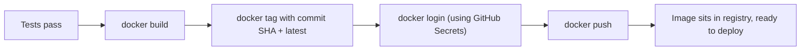

# Chapter 14 — Docker + GitHub Actions

## Concept
Turning CI's "tests passed" into an actual deployable artifact: build the
Docker image in CI, tag it meaningfully, authenticate to a registry, and
push. This is the bridge between CI (chapter13) and CD (chapter16).

## Mental model


## Tagging strategy: latest vs SHA vs semver
| Tag style | Example | Problem it solves / causes |
|---|---|---|
| `latest` | `myapp:latest` | Convenient, but mutable — "latest" today isn't "latest" tomorrow. Never deploy production by this tag alone. |
| commit SHA | `myapp:a1b2c3d` | Immutable, traceable to exact source — best for deploys and rollbacks (chapter21). |
| semantic version | `myapp:1.4.0` | Human-meaningful, good for public releases — pair with SHA internally. |

Best practice: push **both** a SHA tag (source of truth) and `latest`
(convenience pointer), and deploy by SHA.

## Implementation
`examples/.github/workflows/docker-publish.yml` builds the sample app,
tags it with the commit SHA, logs into GitHub Container Registry (GHCR)
using the automatically-provided `GITHUB_TOKEN` (no manual secret needed
for GHCR), and pushes both tags.

## Run / Observe
After a successful run, the image appears under your repo's "Packages" tab
on GitHub, pullable as `ghcr.io/<owner>/<repo>:<sha>`.

## Break it
Remove the `permissions: packages: write` block. The push step fails with
a 403 — GitHub Actions' default `GITHUB_TOKEN` permissions are
increasingly locked down by default, and registry push needs to be
explicitly granted (chapter22 covers least-privilege permissions in depth).

## Debug
```bash
docker pull ghcr.io/<owner>/<repo>:<sha>   # confirm it's really there
docker run --rm ghcr.io/<owner>/<repo>:<sha> curl -f localhost:8000/health || true
```

## Production implications
Never rely on `latest` for rollback — if `latest` moved forward, you've
lost the ability to say "go back to what was running an hour ago." SHA
tags give you a perfect, unambiguous rollback target (chapter21).

## Exercise
See `exercises/01-docker-actions.md`.
