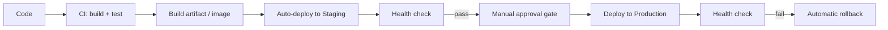

# Chapter 16 — CD / Continuous Delivery

## Concept — three related but distinct terms
| Term | Means | Human gate? |
|---|---|---|
| Continuous Integration | Every change is automatically built + tested | N/A (this is chapter13) |
| Continuous Delivery | Every change that passes CI is automatically packaged and made *ready* to deploy, but a human clicks "go" | Yes, before production |
| Continuous Deployment | Every change that passes CI is automatically deployed, no human gate | No |

Most real orgs do **Continuous Delivery to staging, human-gated deployment
to production** — this chapter builds exactly that.

## Diagram

## Implementation
`examples/.github/workflows/cd.yml`:
1. Builds/pushes the image (reusing chapter14's pattern).
2. Deploys to a `staging` **GitHub Environment** automatically.
3. Runs a health check against staging.
4. Waits for manual approval on a `production` **GitHub Environment**
   (configure required reviewers in repo Settings → Environments).
5. Deploys to production, then health-checks again.

This repo does NOT deploy anywhere real — the "deploy" steps are stand-ins
(`scripts/fake_deploy.sh`, printed as an explicit placeholder) so you can
run the full pipeline logic safely before pointing it at a real target
(a VM, ECS, Kubernetes, etc. — swap in real deploy commands there).

## Run / Observe
Push to `main`. Watch the workflow deploy to staging automatically, then
pause waiting for approval before touching the (simulated) production
target.

## Break it
Make the staging health check fail deliberately (point it at a wrong
port). Confirm the workflow stops there and the production approval gate
never even appears — CD only offers you the *option* to deploy once
staging has proven itself.

## Debug
GitHub's Environments UI (Settings → Environments) shows deployment
history per environment, including who approved what and when — your
audit trail for "who deployed this to prod."

## Production implications
Real deploy steps here would be: `kubectl set image ...`,
`aws ecs update-service ...`, `ssh host "docker compose pull && up -d"`,
or a Terraform apply — the CI/CD *shape* stays identical regardless of
target; only the deploy step's actual command changes.

## Exercise
See `exercises/01-cd.md`.
