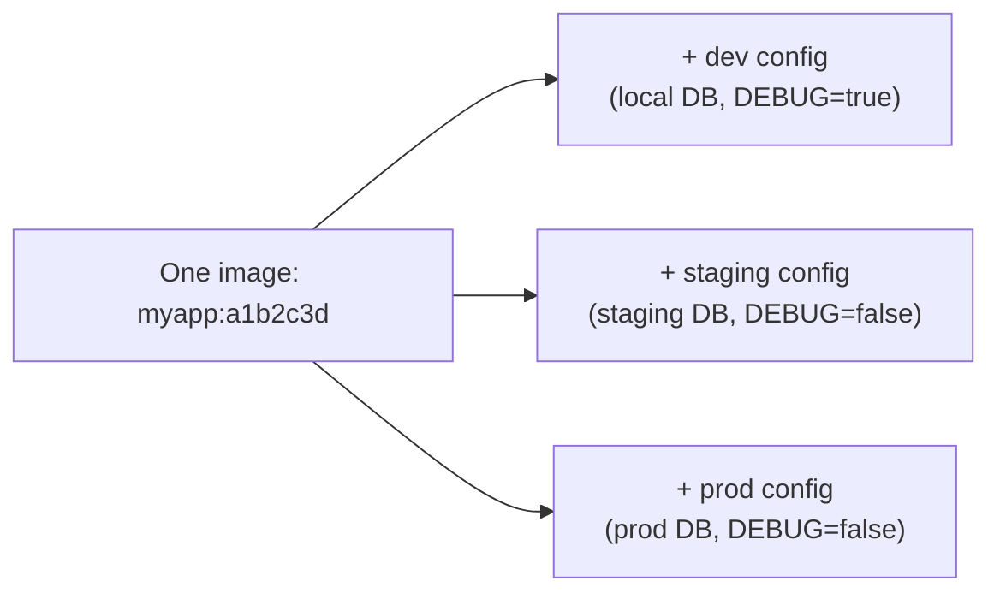

# Chapter 17 — Environment Management

## Concept
Same application binary/image, different behavior per environment
(development, staging, production) — achieved entirely through
**configuration**, never through separate code branches or separate
builds. This is the "build once, promote the same artifact everywhere"
principle: chapter14's SHA-tagged image is what moves from staging to
production unchanged; only its config changes.

## Mental model

If you ever find yourself rebuilding the image differently per
environment, something has gone wrong — config, not code, should vary.

## Config sources, layered
| Source | Committed to git? | Example |
|---|---|---|
| Config files (defaults) | Yes | `config/default.yaml` |
| Environment variables | No (`.env` gitignored) | `DATABASE_URL`, `LOG_LEVEL` |
| Secrets | Never | `DATABASE_PASSWORD`, API keys — see chapter18 |

`sample-app/app/config.py` in this repo reads everything from environment
variables with sane defaults — look at it again with this chapter's lens.

## Implementation
```bash
cp .env.example .env.staging
# edit .env.staging: point DATABASE_URL at a staging DB
docker compose --env-file .env.staging up
```

## Run / Observe
```bash
ENVIRONMENT=staging LOG_LEVEL=DEBUG docker compose up app
docker compose exec app python -c "from app.config import settings; print(settings.environment, settings.log_level)"
```

## Break it
Hardcode `DATABASE_URL` directly in `app/main.py` instead of reading it
from `settings`. Now try to point the same image at a different database
for staging — you can't, without rebuilding the image, which breaks the
"build once, promote everywhere" principle.

## Debug
`docker compose config` prints the fully-resolved compose file with all
environment variable substitutions applied — the fastest way to confirm
what config an environment will actually receive before you `up` it.

## Production implications
`.env` must never be committed — `.env.example` (with placeholder values)
is what's committed, so anyone can see *which* variables exist without
seeing real values. `.gitignore` should always list `.env*` except
`.env.example`.

## Exercise
See `exercises/01-environments.md`.
