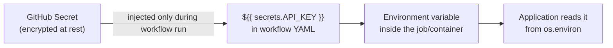

# Chapter 18 — Secrets Management

## Concept
A secret is any value whose exposure causes real harm (DB passwords, API
keys, signing keys). Secrets must never live in source code, Dockerfile
`ENV`/`ARG` (chapter4), git history, or plaintext logs. They flow instead
through a secret store into the runtime environment only.

## Mental model

The secret is decrypted only inside the running job, never written to the
YAML file itself, and GitHub automatically redacts any secret value it
detects in step logs.

## GitHub's secret scopes
| Scope | Visible to |
|---|---|
| Repository secret | All workflows in one repo |
| Environment secret | Only workflows targeting that Environment (e.g. `production`) — pairs with chapter16's approval gates |
| Organization secret | Every repo in the org (or a selected subset) |

## Bad practice (never do this)
```python
# DO NOT DO THIS
DATABASE_PASSWORD = "hunter2"
```
Once committed, it's in git history forever — even if you delete the line
in the next commit, `git log -p` still shows it. Rotation, not deletion,
is the only real fix once a secret leaks.

## Implementation
`examples/.github/workflows/with-secrets.yml` shows a secret flowing from
a GitHub Secret into a container's environment, and confirms GitHub
redacts it in logs even when you deliberately try to print it.

## Run / Observe
Add a repo secret `DEMO_SECRET` = `super-secret-value` in GitHub Settings
→ Secrets, push the example workflow, and look at the log output for the
step that echoes it — GitHub shows `***` instead of the real value.

## Break it — secret scanning
```bash
git log -p | grep -i "password\|api_key\|secret" 
```
Run this on a repo where a secret was ever committed and later "removed"
— it's still there in history. GitHub's own secret scanning does this
automatically and will flag/quarantine leaked secrets it recognizes.

## Debug
If a secret does leak: **rotate it immediately** (generate a new one,
revoke the old one at the source system) — do not just remove it from the
file, since anyone with clone access already has the old value.

## Production implications
For anything beyond a small project, use a dedicated secret manager (AWS
Secrets Manager, Azure Key Vault, GCP Secret Manager, HashiCorp Vault)
rather than long-lived static secrets in CI — these support automatic
rotation, fine-grained access policies, and audit logs of every read.

## Exercise
See `exercises/01-secrets.md`.
