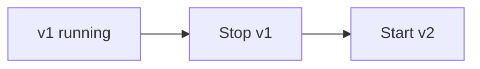
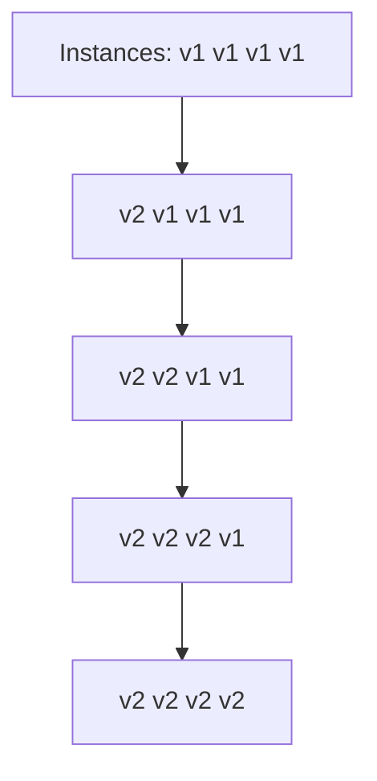
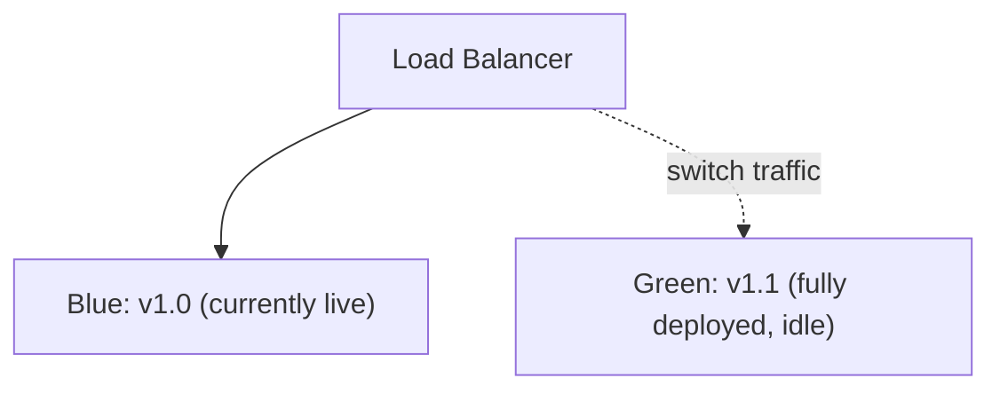
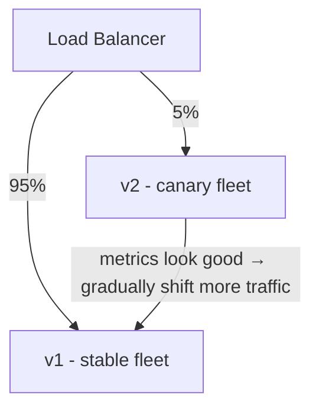

# Chapter 19 — Deployment Strategies

## Concept
"Deploy the new version" can mean five very different things, trading off
downtime, cost, blast radius, and rollback speed differently. Choosing the
wrong one for your risk tolerance is a common production mistake.

## 1. Recreate

Simplest. **Downtime** between stop and start. Fine for internal tools,
never for user-facing services with an SLA.

## 2. Rolling deployment

Replace instances gradually while others keep serving. No full downtime,
but **v1 and v2 run simultaneously for a while** — your API/DB must
tolerate both versions being live at once (chapter20).
- Rollback: resume rolling the old version back in — slow-ish but simple.

## 3. Blue-Green

Deploy v2 fully to an idle environment, test it, then flip the load
balancer all at once. **Instant rollback** — just flip back. Costs 2x
infrastructure while both environments exist.

## 4. Canary

Expose v2 to a small slice of real traffic first, watch error rates/
latency, then ramp up or abort. Best blast-radius control; needs good
metrics and an automated or disciplined manual promotion process.

## 5. Shadow deployment (brief)
Send a **copy** of real traffic to v2 without returning its response to
users at all — pure "does this behave the same/handle the load" test with
zero user-facing risk, at the cost of double processing load.

## Comparison
| Strategy | Downtime | Rollback speed | Infra cost | Blast radius on bad deploy |
|---|---|---|---|---|
| Recreate | Yes | Fast (redeploy old) | 1x | 100% of users, immediately |
| Rolling | No | Medium | 1x (+headroom) | Partial, grows as rollout proceeds |
| Blue-Green | No | Instant | 2x (temporarily) | 0% until flip; 100% after, until flipped back |
| Canary | No | Fast (pull the slice) | 1x (+small) | Small % of users, by design |

## Implementation
`examples/simulate_strategies.py` is a small simulator that models each
strategy's user-impact-over-time for a "bad deploy" scenario, so you can
see the shape of the risk curve for each, not just read about it.
```bash
python3 examples/simulate_strategies.py
```

## Exercise
See `exercises/01-strategies.md`.
