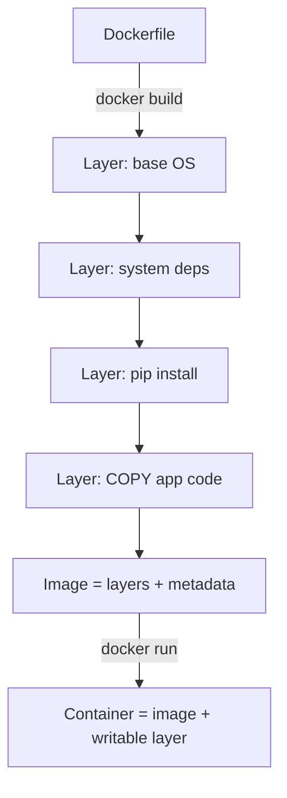

# Chapter 2 — Docker Images

## Concept
An image is a **read-only stack of layers** plus metadata (entrypoint, env,
exposed ports). Each Dockerfile instruction that changes the filesystem
(`RUN`, `COPY`, `ADD`) creates a new layer. A container is just that stack
plus one thin writable layer on top.

## Mental model
Think of layers like Git commits: each one is a diff on top of the last.
Two images sharing the same early layers (e.g. same base image) share
those layers on disk — Docker never stores them twice.

## Diagram


## Implementation
```bash
cd examples
docker build -t layers-demo:v1 .
docker history layers-demo:v1
```
Look at `examples/Dockerfile` — five instructions, five new layers on top
of the base.

## The caching experiment
Build once, touch a file that's copied late, rebuild:
```bash
bash ../scripts/cache_experiment.sh
```
You'll see: layers *before* your change are reused (`CACHED`), layers
*from* your change onward are rebuilt. This is why instruction **order**
matters — put things that change often (your source code) *after* things
that change rarely (dependency installation).

## Run / Observe
```bash
docker images                 # size, ID, tag
docker inspect layers-demo:v1 | less   # full metadata: layers, env, cmd
```

## Break it — bad ordering
`examples/Dockerfile.bad-order` copies source code *before* installing
dependencies. Change one line of source, rebuild, and watch the dependency
install re-run from scratch even though dependencies didn't change:
```bash
docker build -f examples/Dockerfile.bad-order -t bad-order .
# edit examples/src/app.py (change any comment)
docker build -f examples/Dockerfile.bad-order -t bad-order .   # slow rebuild
```

## Debug
`docker history <image>` shows every layer and its size — the fastest way
to find what's bloating an image (see chapter9 for the full fix).

## Production implications
- Tags are mutable pointers, not identities — the same tag (`myapp:latest`)
  can point to a different image tomorrow. **Image IDs (digests) are the
  real identity.** Never deploy by tag alone in production (chapter14).
- Registries (Docker Hub, GHCR) store layers by content hash — pushing an
  image whose layers already exist there is nearly instant.

## Exercise
See `exercises/01-layers.md`.
