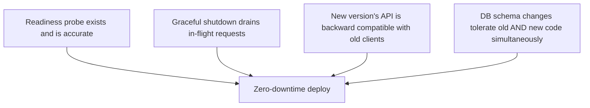
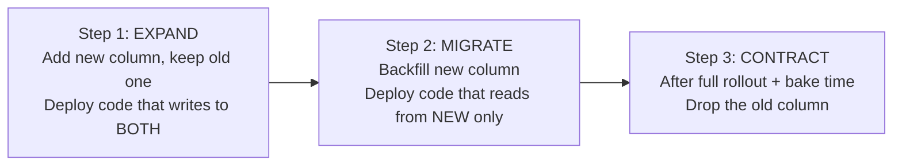

# Chapter 20 — Zero-Downtime Deployments

## Concept
Zero-downtime is not one feature — it's the conjunction of several things
all being true at once: proper health checks, graceful shutdown
(chapter11), backward-compatible APIs during rollout, and a database
migration strategy that tolerates old and new code running together.

## What's required, as a checklist

Miss any one of these and a "zero-downtime" rolling/canary deploy will
still cause errors for some slice of users during the transition window.

## The dangerous combination
> Deploy new application code **+** change the database schema **in the
> same release**

During a rolling/canary rollout, v1 (old code, old schema assumptions) and
v2 (new code) are live at the same time against the **same database**. If
v2's migration already dropped a column v1 reads, v1 starts erroring the
instant the migration runs — before v1 is even fully replaced.

## Expand-and-contract migration strategy

Three separate deploys instead of one — each individually safe for a
rolling/canary rollout, because at every point both old and new code paths
still work against the current schema.

## Implementation
`examples/expand_contract_demo.sql` shows the three migration steps for a
concrete example: renaming a column without ever breaking a live rollout.

## Run / Observe
Read `examples/expand_contract_demo.sql` alongside
`examples/app_versions.py`, which shows the corresponding two code
versions (v1 reading the old column, v2 reading the new one) that must
both work during step 1-2's transition window.

## Break it
Skip straight to `ALTER TABLE ... RENAME COLUMN` in one deploy alongside
new code that only knows the new name. Any v1 instance still running
during rollout now throws `column does not exist` on every request that
touches it.

## Debug
Readiness probes (chapter11's `/ready`) should fail *before* a broken
instance receives traffic, not after — if your health check only pings
`/health` (liveness) instead of `/ready` (readiness with real dependency
checks), your load balancer will happily route traffic to an instance
that's alive but non-functional.

## Production implications
Expand-and-contract adds calendar time (multiple deploys, bake time
between them) in exchange for zero user-facing errors during rollout —
that trade is almost always worth it for anything with real traffic.

## Exercise
See `exercises/01-zero-downtime.md`.
