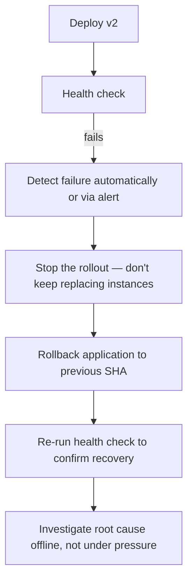

# Chapter 21 — Rollbacks

## Concept
Four different things can need rolling back, and they don't roll back the
same way or at the same speed:

| Kind | Rollback mechanism | Speed |
|---|---|---|
| Application | Redeploy previous SHA-tagged image (chapter14) | Fast |
| Configuration | Revert the config change / previous `.env` values | Fast |
| Artifact | Point traffic back at the previous build's artifact | Fast |
| Database | Reverse migration, or point-in-time restore | **Often slow, sometimes impossible** |

## Why database rollback isn't trivial
An `ALTER TABLE ... DROP COLUMN` cannot be "rolled back" by re-adding the
column — the **data** in that column is gone. Some migrations are
genuinely irreversible without a backup. This is the real justification
for expand-and-contract (chapter20): each individual migration step stays
small and reversible, so you're never one bad deploy away from
unrecoverable data loss.

## Diagram — a deployment failure and recovery workflow


## Implementation
`examples/rollback.sh` takes a previous known-good SHA and redeploys it —
exactly the "flip back to the last image" half of rollback. Database
rollback is deliberately NOT automated here — it requires a human judgment
call about which migration state is actually safe to return to.

## Run / Observe
```bash
bash examples/rollback.sh ghcr.io/<owner>/sample-app:<previous-sha>
```

## Break it — the case where app rollback isn't enough
Roll back the application to a pre-migration version while the database
schema is already post-migration (i.e. you did the DROP COLUMN before
confirming the new app version was healthy). The "rolled back" old app now
crashes too — it expects a column that no longer exists. **This is why
expand-and-contract's CONTRACT step should only happen after real bake
time**, not immediately after the MIGRATE step.

## Debug
Keep a rollback runbook that states, per service, exactly which command
reverts application code and — separately and explicitly — whether the
current database state is safe for both the new AND previous app version.
If it isn't, application rollback alone will not fix the incident.

## Production implications
Automate the fast, safe rollback path (application/config) so it can
happen in seconds during an incident. Treat database rollback as a
separate, more deliberate decision — never bundle it into an automatic
"rollback" button.

## Exercise
See `exercises/01-rollbacks.md`.
