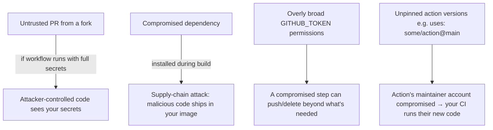

# Chapter 22 — CI/CD Security

## Concept
Your CI/CD pipeline has write access to your registry, your secrets, and
often your production environment — it IS part of your production attack
surface, not a neutral internal tool.

## Attack surface areas

## Concrete practices
| Risk | Mitigation |
|---|---|
| PRs from forks running with secrets | Use `pull_request_target` carefully or split "build untrusted code" (no secrets) from "deploy" (secrets, only on `main`) jobs |
| Overly broad token permissions | Set `permissions:` explicitly per workflow/job — default to read-only, add only what's needed (chapter14's `packages: write` example) |
| Unpinned third-party actions | Pin to a full commit SHA, not a floating tag: `uses: actions/checkout@<sha>` not `@v4` (or at minimum, pin to a specific version tag, never `@main`) |
| Dependency vulnerabilities shipping in the image | Scan images in CI (chapter10) and fail the pipeline on high-severity CVEs, don't just scan post-hoc |
| Artifact tampering between build and deploy | Verify the image digest deployed matches the digest built — don't trust a mutable tag across that gap |

## Implementation
`examples/.github/workflows/hardened-ci.yml` demonstrates: explicit
minimal `permissions:`, a pinned action SHA, and a `trivy` scan step that
fails the build on critical CVEs.

## Run / Observe
Compare this workflow's `permissions:` block against chapter13/14's
simpler examples — note how much narrower it is once you're being
deliberate.

## Break it
Use `uses: some-action@main` in a workflow (floating branch reference).
Explain the exact scenario in which this becomes a supply-chain risk
(hint: what happens if that action's maintainer's account is compromised
tomorrow and pushes malicious code to `main`?).

## Debug
`gh api` or the Security tab's Dependabot/code-scanning alerts surface
known-vulnerable dependencies proactively — don't rely solely on manually
remembering to scan.

## Production implications
Treat your CI/CD configuration with the same review rigor as production
code — a malicious or accidental change to a workflow file is a change to
your deployment pipeline's trust boundary.

## Exercise
See `exercises/01-cicd-security.md`.
