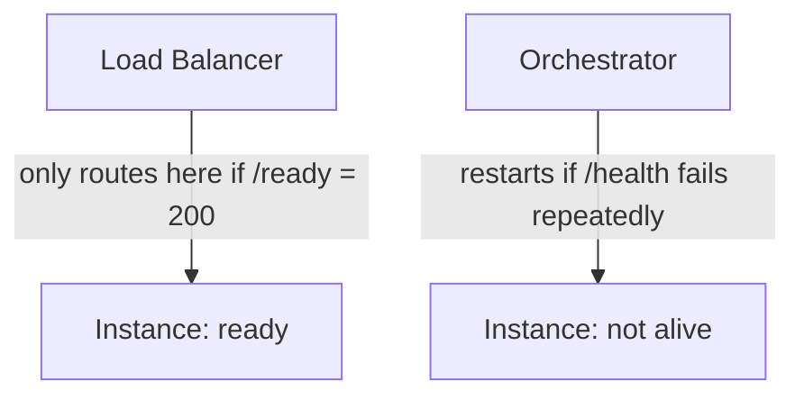
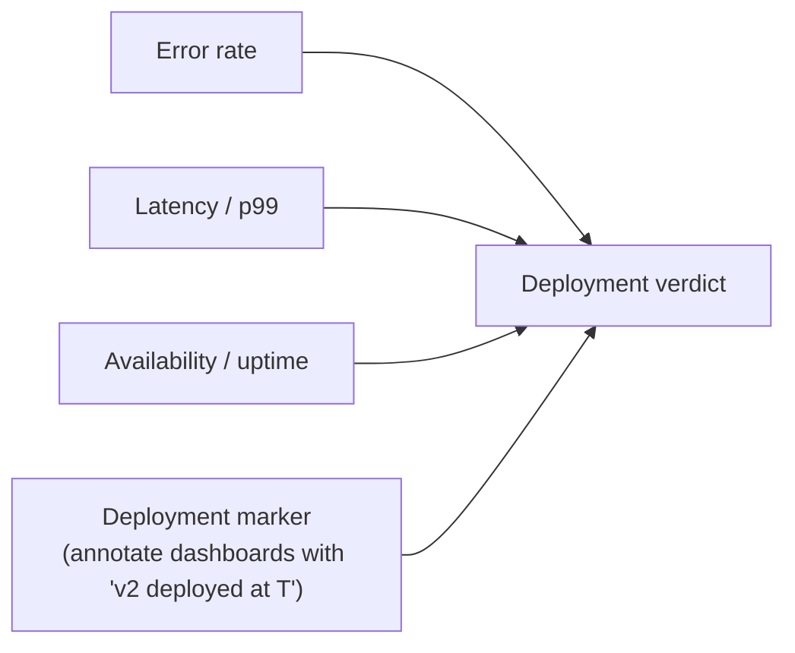

# Chapter 23 — Observability & Deployment

## Concept
A deployment isn't "done" when the new containers are running — it's done
when you can *prove* the new version is healthy under real traffic.
Observability (logs, metrics, health checks) is what lets you tell the
difference between "deployed" and "actually working."

## Liveness vs Readiness
| Probe | Question it answers | Failure action |
|---|---|---|
| Liveness (`/health`) | Is the process itself alive (not deadlocked/hung)? | Restart the container |
| Readiness (`/ready`) | Can this instance serve traffic *right now*? | Stop routing traffic to it, but don't necessarily restart it |

`sample-app` already implements both (see chapter1/chapter20) — liveness
never checks dependencies, readiness checks Postgres and Redis explicitly.

## Diagram


## The four signals to watch during any deploy

A deployment marker on your metrics dashboard is what turns "latency
spiked at 14:32" into "latency spiked at 14:32, right when v2 went out" —
without it you're guessing at correlation.

## Implementation
`examples/log_and_metrics_demo.py` shows structured JSON logging (so logs
are machine-parseable) plus a minimal request counter/latency histogram
pattern using plain Python, illustrating the shape without requiring a
full observability stack (Prometheus/Grafana/Datadog) to follow along.

## Run / Observe
```bash
python3 examples/log_and_metrics_demo.py
```
Note the structured (JSON) log lines — this is what lets you grep/query
logs at scale instead of parsing free-text strings.

## Break it
Deploy a version with a subtle bug that only shows up under real
production load patterns (e.g. a slow DB query only slow on the real data
volume). If you're only watching "is it up" (liveness) and not p99 latency,
you won't notice for a long time — this is why liveness alone is
insufficient observability for a deploy.

## Debug
Correlate: deployment marker timestamp vs. error-rate/latency graph. If
they move together, the deploy is implicated; if not, look elsewhere.

## Production implications
Instrument `/ready` to check the things that actually predict serving
capability (DB, cache, any hard dependency) — not everything the app ever
touches (an optional third-party API being briefly down shouldn't make
your own service report not-ready).

## Exercise
See `exercises/01-observability.md`.
