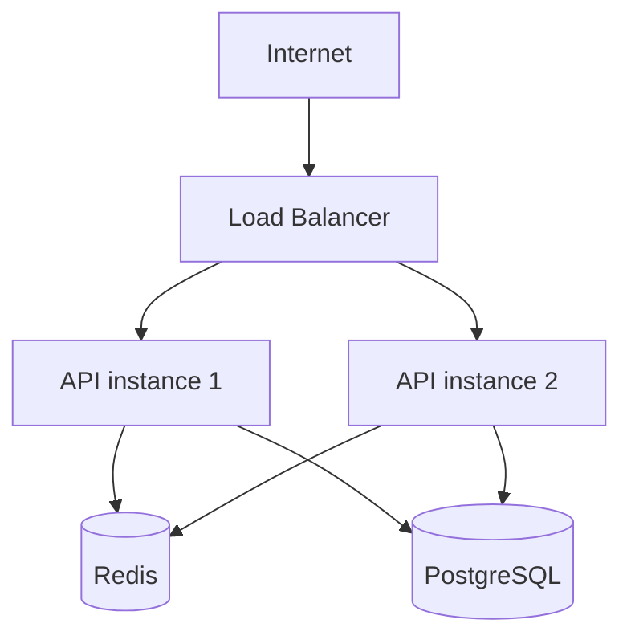
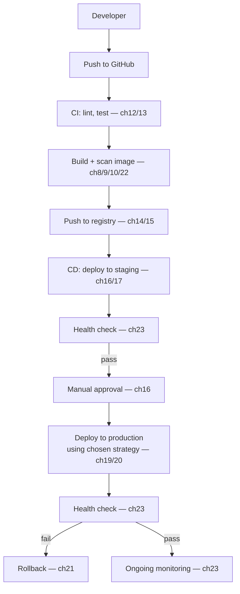

# Chapter 24 — Production Architecture

## Concept
This chapter doesn't teach a new tool — it assembles chapters 1-23 into
one coherent picture of what "production" actually looks like end to end,
from a developer's laptop to a running, observed, rollback-capable
service.

## The runtime architecture

Multiple stateless API instances behind a load balancer, sharing stateful
backing services (chapter6's volumes live under these, not under the
API instances themselves — API instances are fully disposable).

## The delivery pipeline

## How this repo maps onto that picture
| Piece | Where in this repo |
|---|---|
| The app | `sample-app/` |
| Local multi-service stack | root `docker-compose.yml` (chapter7) |
| CI | `chapter13/examples/.github/workflows/ci.yml` |
| Build+push | `chapter14/examples/.github/workflows/docker-publish.yml` |
| CD with staging/prod gate | `chapter16/examples/.github/workflows/cd.yml` |
| Rollback | `chapter21/examples/rollback.sh` + workflow |
| The fully assembled version | `final-project/` |

## Implementation
Read `final-project/README.md` now — it's this diagram, made real, with
every workflow file actually wired to `sample-app`'s codebase copy.

## Exercise
See `exercises/01-architecture.md`.
