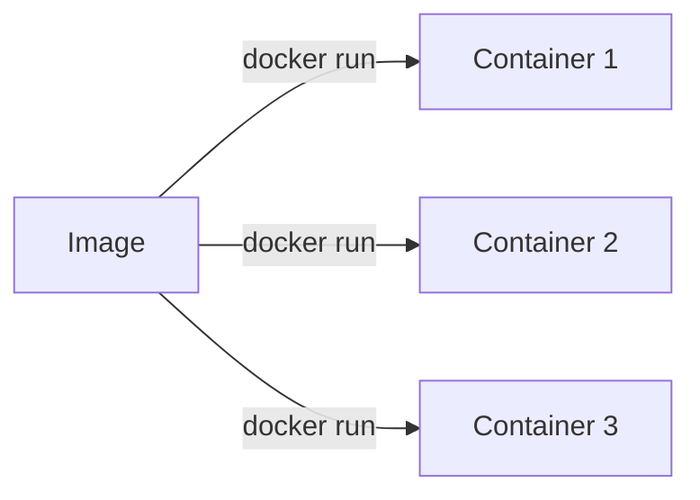
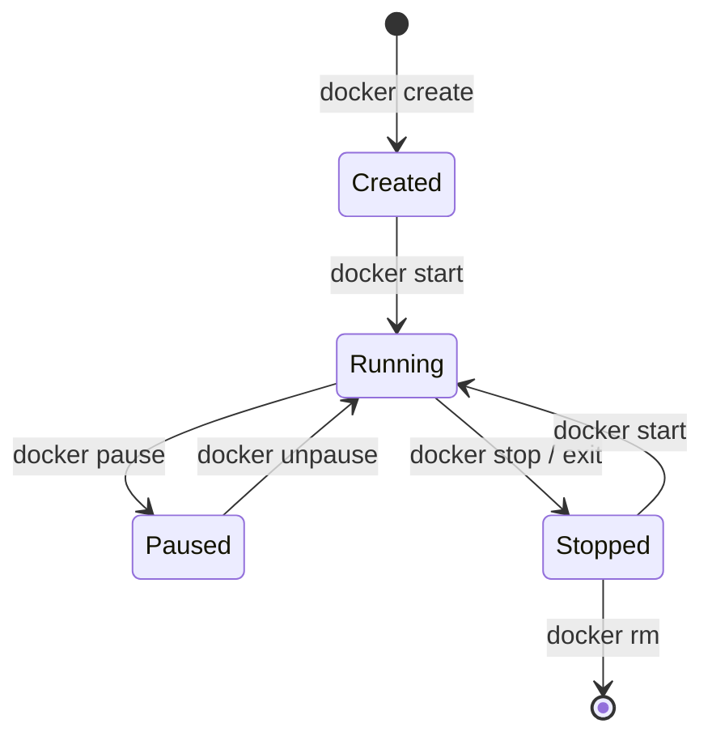

# Chapter 3 — Docker Containers

## Concept
An **image** is a template. A **container** is a running (or stopped)
instance of that template — one image can back many simultaneous
containers, each with its own writable layer, network namespace, and
lifecycle.

## Mental model
Image : Container :: Class : Object. `docker run` = instantiation.

## Diagram


Lifecycle:


## Implementation
```bash
docker build -t chapter3-demo examples/
docker run -d --name demo -p 8080:8000 chapter3-demo
docker ps
curl localhost:8080
docker logs demo
docker exec -it demo sh
docker stop demo
docker start demo
docker rm -f demo
```

## Commands reference
| Command | Does |
|---|---|
| `docker run` | create + start in one step |
| `docker ps` / `docker ps -a` | list running / all containers |
| `docker stop` | send SIGTERM, wait, then SIGKILL |
| `docker start` | resume a stopped container (same filesystem state) |
| `docker restart` | stop then start |
| `docker exec -it <c> sh` | run a new process inside a running container |
| `docker logs -f` | stream stdout/stderr |
| `docker inspect` | full JSON state: IP, mounts, env, exit code |
| `docker rm` / `docker rm -f` | remove stopped / force-remove running |

## Run / Observe
`docker start` after `docker stop` preserves the writable layer — files
you created are still there. `docker rm` destroys it permanently.

## Break it
```bash
docker run -d --name crashy chapter3-demo sh -c "exit 1"
docker ps -a          # Exited (1)
docker logs crashy    # see why
```

## Debug
`docker inspect crashy --format '{{.State.ExitCode}}'` gives you the exact
exit code to correlate against your app's documented exit codes.

## Production implications
Containers are meant to be **disposable** — `docker rm -f` and recreate
from the image, rather than `docker exec`-ing in to hand-patch a running
container. If you find yourself doing the latter in production, that's a
sign your image or config isn't capturing the real desired state.

## Exercise
See `exercises/01-lifecycle.md`.
