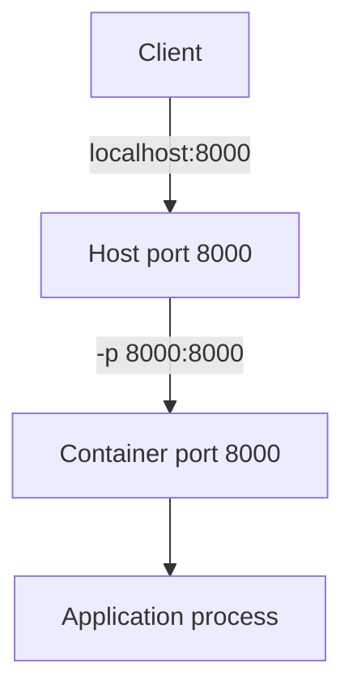
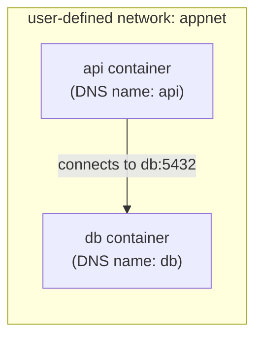

# Chapter 5 — Docker Networking

## Concept
By default, `docker run` attaches a container to Docker's `bridge`
network — a private virtual network on the host. Containers on the same
bridge can reach each other by IP; on a **user-defined** bridge (or a
Compose network) they can also reach each other **by name**, via Docker's
built-in DNS.

## Mental model
Think of a Docker network as a virtual switch. Containers plugged into
the same switch can talk directly. A port mapping (`-p`) is a hole punched
through the host's firewall into one specific container's port.

## Diagram



## Network types
| Type | Use |
|---|---|
| `bridge` (default) | isolated, containers reach each other by IP only, no DNS |
| user-defined bridge | isolated + built-in DNS by container/service name — **use this** |
| `host` | container shares the host's network stack directly, no isolation, no port mapping needed |
| `none` | fully isolated, no networking at all |

## Implementation
```bash
docker network create appnet
docker run -d --name db --network appnet postgres:16-alpine \
  -e POSTGRES_PASSWORD=pw
docker run --rm --network appnet postgres:16-alpine \
  psql -h db -U postgres -c "select 1"   # resolves 'db' via Docker DNS
```

## Run / Observe
```bash
docker network ls
docker network inspect appnet     # see connected containers, subnet, gateway
docker inspect db --format '{{.NetworkSettings.Networks.appnet.IPAddress}}'
```

## Break it
```bash
docker run --rm postgres:16-alpine psql -h db -U postgres -c "select 1"
```
This fails — no `--network appnet`, so this container is on the *default*
bridge, which has no DNS entry for `db` at all.

## Debug
```bash
docker run --rm --network appnet alpine sh -c "apk add --no-cache bind-tools && nslookup db"
```
Confirms whether DNS resolution is the problem vs. a port/firewall issue.
Also check `docker port <container>` to confirm what's actually published.

## Production implications
- Compose (chapter7) creates a user-defined network automatically — this
  is *why* `depends_on: db` + connecting to hostname `db` just works there.
- `--network host` skips Docker's networking overhead entirely but loses
  isolation and can't be used for multiple containers wanting the same
  port — avoid in production unless you specifically need host-level
  network access (e.g. certain monitoring agents).

## Exercise
See `exercises/01-networking.md`.
