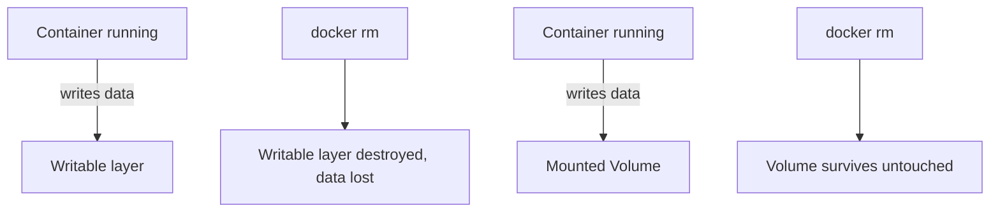

# Chapter 6 — Volumes & Storage

## Concept
A container's writable layer dies with the container. Anything that must
survive — a database's data, uploaded files — needs to live outside that
layer, in either a **volume** (Docker-managed storage) or a **bind mount**
(a specific host path).

## Mental model
The container filesystem is a scratchpad. Volumes are the filing cabinet
next to the desk — the desk gets cleared, the cabinet doesn't.

## Diagram


## Volumes vs bind mounts vs tmpfs
| Type | Managed by | Location | Use case |
|---|---|---|---|
| Volume | Docker | `/var/lib/docker/volumes/...` | Databases, portable persistent data |
| Bind mount | You | Any host path you specify | Local dev — live-mount your source code |
| tmpfs | Docker (in-memory) | RAM, never touches disk | Secrets/scratch space that must never persist |

## Implementation — Postgres with a volume
```bash
docker volume create pgdata
docker run -d --name pg -v pgdata:/var/lib/postgresql/data \
  -e POSTGRES_PASSWORD=pw postgres:16-alpine
docker exec pg psql -U postgres -c "create table t(x int); insert into t values (1);"
```

## Run / Observe — the data survives container deletion
```bash
docker rm -f pg
docker run -d --name pg2 -v pgdata:/var/lib/postgresql/data \
  -e POSTGRES_PASSWORD=pw postgres:16-alpine
sleep 3
docker exec pg2 psql -U postgres -c "select * from t;"   # row is still there
```

## Break it
```bash
docker run -d --name pg3 -e POSTGRES_PASSWORD=pw postgres:16-alpine
docker exec pg3 psql -U postgres -c "create table gone(x int);"
docker rm -f pg3
docker run -d --name pg4 -e POSTGRES_PASSWORD=pw postgres:16-alpine
docker exec pg4 psql -U postgres -c "select * from gone;"   # ERROR: relation does not exist
```
No volume was mounted, so `pg4` started from a completely fresh, empty
data directory — `pg3`'s table is gone forever.

## Debug
```bash
docker volume ls
docker volume inspect pgdata     # real host path under Mountpoint
docker inspect pg2 --format '{{json .Mounts}}' | python3 -m json.tool
```

## Production implications
- Deleting a container is safe *only if* its state lives in a volume (or
  an external DB). Treat the container itself as fully disposable.
- `docker compose down` leaves volumes intact; `docker compose down -v`
  deletes them — a common source of "I lost my dev database" incidents.
- In orchestrated environments (k8s), the volume equivalent (PersistentVolume)
  is what actually needs backup — the containers/pods themselves never do.

## Exercise
See `exercises/01-volumes.md`.
