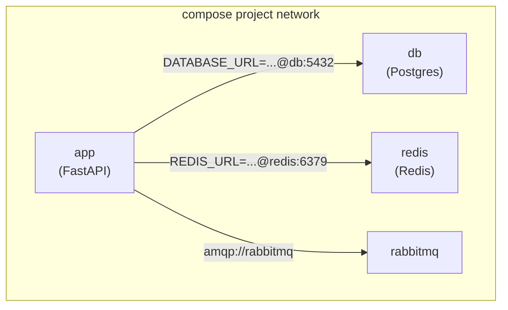

# Chapter 7 — Docker Compose

## Concept
Compose describes a multi-container application declaratively in YAML —
services, the network connecting them, volumes, environment, and startup
ordering — so `docker compose up` replaces a long sequence of manual
`docker run`/`docker network create`/`docker volume create` commands.

## Mental model
Compose is a thin orchestration layer over the primitives from chapters
5-6: it creates one shared user-defined network per project automatically,
so every service can reach every other service by its service name.

## Diagram


## Implementation
The root `docker-compose.yml` in this repo already wires up
`app + db + redis`. Read it now — every field maps to something from
chapters 5-6:
- `depends_on: condition: service_healthy` — don't start `app` until `db`
  and `redis` pass their `healthcheck`.
- `env_file: .env` — chapter17 territory.
- `volumes: pgdata:` — chapter6's named volume, declared once, referenced
  by service.

`examples/` in this chapter adds RabbitMQ on top, standalone, so you can
see one more service wired in without touching the main stack.

## Run / Observe
```bash
cd examples
docker compose up --build -d
docker compose ps
docker compose logs -f app
docker compose exec app sh
docker compose down
```

## Break it
Remove the `healthcheck` and `depends_on: condition:` from `db` in
`examples/docker-compose.yml`, leaving plain `depends_on: [db]`. Restart
the stack repeatedly — occasionally `app` will start and try to connect
before Postgres is actually ready to accept connections (`depends_on`
without a healthcheck only waits for the container to *start*, not to be
*ready*).

## Debug
```bash
docker compose ps                  # which service is unhealthy/exited?
docker compose logs db             # did Postgres actually finish init?
docker compose exec app env        # is DATABASE_URL what you expect?
```

## Production implications
Compose is excellent for local dev and single-host deployments. For
multi-host production scale you'd move to Kubernetes or a managed
container platform — but the mental model (services, declarative desired
state, health-gated startup) carries over directly, which is why it's
worth learning properly here first.

## Exercise
See `exercises/01-compose.md`.
