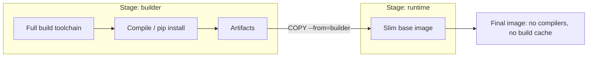

# Chapter 8 — Multi-stage Builds

## Concept
A multi-stage Dockerfile has more than one `FROM`. Earlier stages can
install compilers, dev headers, and build tools; only the files you
explicitly `COPY --from=<stage>` make it into the final image. Everything
else — the entire builder stage — is discarded.

## Mental model
Builder stage = messy workshop. Runtime stage = the clean showroom you
actually ship. You carry the *finished product* across, not the workshop.

## Diagram


## Implementation
`examples/Dockerfile.single-stage` and `examples/Dockerfile.multi-stage`
build the same app. Compare:
```bash
bash scripts/compare_sizes.sh
```

## Run / Observe
The single-stage image contains `gcc`, apt lists, pip's download cache —
none of which the running app needs. The multi-stage image contains only
Python + installed packages + your code.

## Break it
```bash
docker run --rm single-stage-demo which gcc     # found — attack surface, wasted space
docker run --rm multi-stage-demo which gcc      # not found — as intended
```

## Debug
`docker history <image>` on both — the multi-stage image's layer list is
dramatically shorter because the builder stage's layers never made it in.

## Production implications
- Smaller image = faster pulls = faster deploys = faster rollbacks.
- Fewer installed tools (compilers, package manager caches) = smaller
  attack surface if the container is ever compromised (chapter10).
- You can have more than two stages — e.g. a `test` stage that runs your
  test suite and is never used as a base for anything, just as a CI gate
  (see chapter13).

## Exercise
See `exercises/01-multistage.md`.
