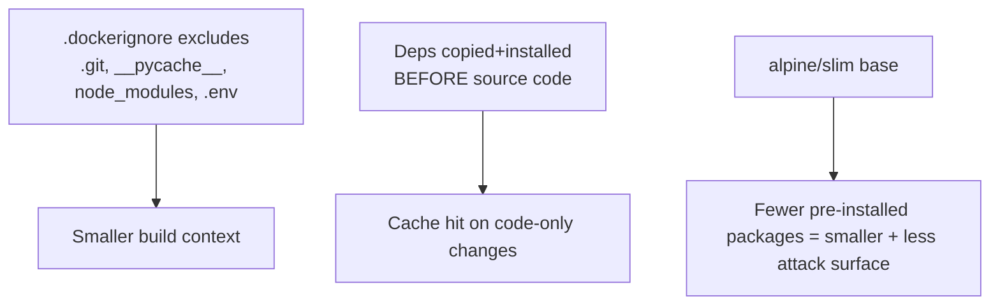

# Chapter 9 — Docker Image Optimization

## Concept
Beyond multi-stage builds, four levers control image size and build speed:
`.dockerignore` (don't send junk into the build context at all), layer
ordering (maximize cache hits), base image choice (alpine/slim vs full
distro), and dependency caching (don't reinstall unchanged deps).

## Mental model
Every byte you `COPY` is a byte Docker has to hash, store, and transfer on
every pull. Every early-layer change invalidates every layer after it.
Optimization is just "minimize both."

## Diagram


## Implementation — before/after
```bash
bash scripts/optimize_demo.sh
```
This builds `examples/Dockerfile.unoptimized` (no `.dockerignore`, full
`python:3.12`, source copied before deps) against
`examples/Dockerfile.optimized` (slim base, `.dockerignore`, deps-first
ordering) and prints both build context size and final image size.

## Run / Observe
```bash
docker build -f examples/Dockerfile.unoptimized examples --no-cache -q  # note build time
docker build -f examples/Dockerfile.optimized examples --no-cache -q    # note build time
# then touch only source and rebuild both — optimized should be much faster
```

## Break it
Delete `.dockerignore` and rebuild `examples/Dockerfile.optimized` — watch
"Sending build context to Docker daemon" report a much larger size because
`.git` and `__pycache__` are now included for no reason.

## Debug
```bash
docker build --progress=plain -f examples/Dockerfile.optimized examples
```
Plain progress output shows exactly how long each layer took and which
ones were cache hits — use this to find your actual bottleneck rather than
guessing.

## Production implications
| Base image | Typical size | Tradeoff |
|---|---|---|
| `python:3.12` (full Debian) | ~1GB | Convenient, everything's there, largest |
| `python:3.12-slim` | ~150MB | Good default for most apps |
| `python:3.12-alpine` | ~50MB | Smallest, but musl libc can break some C-extension wheels — test before committing |

Alpine's `musl` libc (vs Debian's `glibc`) is the classic gotcha: some
Python packages with compiled extensions either fail to install or behave
subtly differently on Alpine. `-slim` is the safer default; drop to
Alpine only after verifying your specific dependency tree.

## Exercise
See `exercises/01-optimize.md`.
